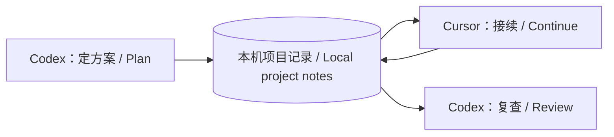

# Multiple-Agent-Memory-Exchage

[中文](#中文) · [English](#english) · [Download v0.2.1-preview](https://github.com/LevinShi/Multiple-Agent-Memory-Exchage/releases/tag/v0.2.1-preview)

## 中文

### 换个 AI 工具，接着做，不用从头解释

在 Codex 定了方案，换到 Cursor 却又要复制聊天、重讲约束？这个项目把**决定、进展和下一步**留在本机，让获准参与的 Agent 接上同一个项目。

你少做手工交接，工具少重复已完成的工作。适合经常在多个 AI 编程工具之间切换的人；首次需要配置权限和入口规则，之后以自然语言接力为目标。

### 一个接力例子

1. **Codex：**“在 demo 项目里做读书清单，只用本地存储。”
2. **Cursor：**“继续 demo 项目，实现添加书籍。”
3. **回到 Codex：**“看看现在做到哪里，检查遗漏。”

工具应读取已有约束、推进任务并保存新进展。以上是说明性例子；首次使用仍要核对实际读写。代码目录需要双方都能访问，本项目不负责同步代码。

### 三步试用

1. 下载源码，解压后运行 `python3 demo.py`，先看不调用模型的离线演示。
2. 按[使用指南](docs/USER-GUIDE.md)建立 demo 库，把生成的入口规则加入两个工具。
3. 只说“继续 demo 项目”，确认第二端读到前一端记录，并自动保存新进展。

环境：macOS / Linux、Python 3.10+。提供 Codex、Cursor、ZCode、MiniMax Code 入口模板；模型是否遵守规则需要实测。普通网页聊天不能直接读取本机库。

### 下载前的三个问题

**为什么不直接用一个 Markdown？** 简单交接当然可以。本项目多做的是项目权限检查、来源与修订记录，以及可核对的读写轨迹。

**所有聊天都会共享吗？** 不会。项目默认拒绝访问，授权后才共享必要进展。它是合作型 Agent 的工作流门禁，不是抵御恶意程序的安全沙箱。云端模型读取的上下文仍可能发给其服务商。

**当前成熟度如何？** 这是预览版，发布时四组远端 CI 通过；真实接力只在部分客户端验证。Gemini 采集是可选实验功能，线上测试仍暂停，不是核心使用前提。

[使用与详细 FAQ](docs/USER-GUIDE.md) · [权限](docs/PERMISSIONS.md) · [接入](docs/CLIENTS.md) · [路线图](docs/ROADMAP.md)

## English

### Switch AI tools without starting the conversation over

You agree on a plan in Codex, then switch to Cursor—and have to explain it all again. This project keeps **decisions, progress, and next steps** on your computer so authorized agents can pick up the same project.

Spend less time copying summaries and repeating work. It is designed for people who use more than one AI coding tool. Permissions and client rules need a one-time setup; after that, the aim is to hand work over in plain language.

### One handoff, three turns

1. **In Codex:** “Build a reading list in the demo project. Store data locally.”
2. **In Cursor:** “Continue the demo project. Implement adding a book.”
3. **Back in Codex:** “Check the current progress and look for gaps.”

Each tool is expected to read the existing constraints, do its part, and save an update. This is an illustrative example, not a guarantee: verify the first handoff in your own clients. Both tools also need access to the code; this project shares context, not source files. The diagram above shows the flow.

### Try it in three steps

1. Download and extract the source, then run `python3 demo.py`. The offline demo does not call any models.
2. Follow the [setup guide](docs/QUICKSTART-EN.md) to create a demo vault and add its generated rules to two tools.
3. Say “Continue the demo project.” Check that the second tool reads the first tool’s notes and saves its own progress.

Requires macOS or Linux and Python 3.10+. Rule templates are provided for Codex, Cursor, ZCode, and MiniMax Code. Actual compliance depends on the client and model. Ordinary web chats cannot directly access this local vault.

### Three things to know

**Why not just use a Markdown file?** For a simple handoff, you can. This project adds project-level access checks, source and revision tracking, and a record of reads and writes you can inspect.

**Does it share every conversation?** No. Access is denied by default; authorized projects share selected progress notes. This is a workflow gate for cooperative agents, not a sandbox against hostile software. Context read by a cloud-based model may still be sent to that model’s provider.

**How ready is it?** This is a preview. All four CI jobs passed for the release, but real handoffs have only been verified in some clients. Gemini capture is optional and experimental; live testing remains paused. You do not need it to use shared project memory.

[English setup](docs/QUICKSTART-EN.md) · [Detailed guide, Chinese](docs/USER-GUIDE.md) · [Security](SECURITY.md) · [MIT License](LICENSE)
