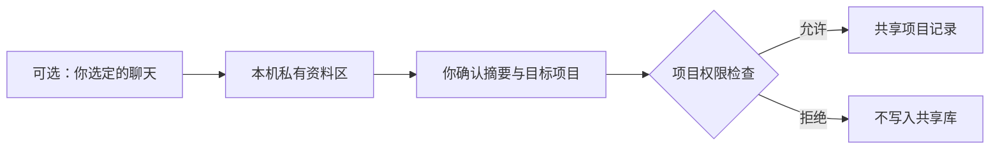

# 使用指南与详细问答

## 先用一个无敏感项目试一遍

你需要 **macOS 或 Linux、Python 3.10+，以及能执行本地命令的 AI 编程工具**。不需要为这个项目注册账号、购买数据库或填写模型 API Key；你所用 AI 工具本身的账号和费用不变。原生 Windows 暂不支持。

### 1. 下载，先看一次离线演示

从 [Release](https://github.com/LevinShi/Multiple-Agent-Memory-Exchage/releases/tag/v0.2.1-preview) 下载源码 ZIP，解压，在代码目录打开终端：

```sh
python3 demo.py
```

它用临时合成资料演示“第一端写入 → 第二端接续 → 第一端回读”，还会检查未授权访问被拒绝、导出保持关闭。看到 `synthetic_cli_relay: passed`，表示本机程序演示通过。

**这个演示不启动 Codex 或 Cursor，也不访问 Gemini。** 它让你先确认程序能运行；真实 Agent 接力在下一步验证。

不熟悉终端，也可以把下面这段话交给本地编程 Agent：

> 在我刚解压的 Multiple-Agent-Memory-Exchage 目录里，先读 README 并运行离线 demo。通过后建立一个新的 demo 记忆库，帮我配置当前工具的入口规则，保留已有规则。只使用合成资料，不启用 Gemini 采集，不扩大真实项目权限。最后告诉我第二个工具还需要配置什么。

### 2. 建立 demo 库，给两个工具接上入口

```sh
python3 init_vault.py "$HOME/local-agent-memory-demo" --demo
```

它创建一个独立的本地目录，为名为 `demo` 的示例项目开放四端读写，不开放导出。**这个授权只用于示例，不代表你的真实项目都应该共享。** 如果目录已存在，程序会拒绝覆盖，请换一个新目录。

新目录里会生成各工具的入口说明，例如 `ENTRY-codex.md`、`ENTRY-cursor.md`。把对应内容加入你准备试用的两个客户端的默认规则，保留原规则，再开启新会话。不同工具的放置位置见[客户端接入说明](CLIENTS.md)。

### 3. 只用自然语言，完成上面的读书清单接力

成功标准很具体：

- 第一端没有被提醒“记一下”，仍自动保存了决定和下一步。
- 第二端没有收到你复制的摘要，仍读到了前一端的记录并据此继续。
- 回到第一端，能读到第二端新增的进展。

第一次请展开工具调用确认：首个共享库操作是 `gateway.py begin`；结束有 `save` 返回的记录 ID；另一端有读取结果。仅聊天里说“已保存”不算通过。运行入口操作后，库目录中会生成本地 `dashboard.html` 状态页；用浏览器打开并刷新，可看入口记录到的最近操作，不含聊天正文。

### 4. 确认有用，再接入真实项目

创建另一个没有默认授权的库：

```sh
python3 init_vault.py "$HOME/local-agent-memory-vault"
```

然后明确告诉维护 Agent：“项目 A 只给 ZCode；项目 B 给 Codex 和 Cursor 读写；都不允许导出。”由它按你的决定配置权限。详细格式见[项目权限说明](PERMISSIONS.md)。新项目没有授权时，入口默认拒绝。

## 下载前，你可能想问

### 我自己写一个 Markdown 交接文档，为什么还需要它？

如果你愿意每次手工更新，单个 Markdown 完全可以满足简单交接。本项目增加的是一套可重复执行的流程：先检查项目权限，再给上下文；保存来源与修订关系；留下可核对的操作记录。价值在于把交接习惯做成各工具的默认工作方式，而不是 Markdown 格式本身。

### 配置一次后，真的不用每次提醒读取和保存吗？

这是设计目标，但不是模型行为保证。入口规则要求工具开始时读取、结束时保存；模型可能忽略规则，客户端升级也可能改变加载方式。因此先用一个 demo 验证你自己的两个工具。首次配置和项目授权仍需要你决定，日常接力不应每轮重复查存口令。

### 会把我的所有聊天都收集起来吗？

不会。核心记录的是 Agent 保存的必要进展。可选的 Gemini 采集只针对你显式选择的网页会话，原文另存私有区；要分享摘要，还需指定内容和目标项目。使用共享记忆核心不需要安装采集扩展。



### “本地保存”是不是意味着内容不会到云端？

本项目自身没有云端中转或同步服务，文件留在本机。但如果你使用云端模型的编程工具，它读取的上下文可能随请求发给该工具的模型服务商。**本地存储不等于模型离线推理。** 是否处理敏感资料，还要看你所用客户端和模型的配置。

### 能阻止一个不守规则的 Agent 偷读其他项目吗？

不能把它当作强安全隔离。权限入口能阻止正常流程中的未授权操作，但客户端身份由工具自报；同一系统用户下的进程可能直接读取文件绕过入口。适合管理合作型 Agent 的共享范围，不适合以此隔离敌对程序或不同保密等级的数据。详见[安全边界](../SECURITY.md)。

### “不共享”会不会把原来的工具也锁在外面？

不会，只要给原属工具保留独占读写授权。比如只给 ZCode 的项目，它可以继续写，其他工具通过入口会被拒绝。撤销权限不删除历史，也不能收回别人之前已经复制的内容。

### 会不会越用越大，占满磁盘？

核心只应保存必要进展，不默认复制全部聊天或下载附件；共享记录目前没有全库硬容量上限。可选私有采集按内容去重，默认上限 50 MiB，达到上限暂停而不是自动删原文。软删除会保留原文，备份和 Git 历史另占空间；原子写入也需要临时空间。它适合先做个人小规模试点，不是无限容量的聊天仓库。

### 能接力代码、同步不同电脑，或让所有工具共用一个“人格”吗？

它能共享你明确写下的约束、工作习惯和项目进度；不会同步代码目录、不同电脑的文件，也不能让不同模型表现完全相同。跨电脑文件同步、后台 Agent 调度和统一聊天窗口都不是当前能力。

### Gemini 采集现在建议开启吗？

建议先试共享记忆核心。采集是实验能力，长历史、复杂回复与真实账号切换仍待验收；当前维护者已暂停线上测试。不要为了验证插件反复向 Gemini 发请求。需要了解时看[采集说明](GEMINI-CAPTURE.md)，不要把短会话实测理解为长期稳定性或账号安全保证。

### 下载后，我的资料会跟着提交到这个公开仓库吗？

不会自动上传。请把自己的记忆库放在代码仓库之外，不要把 `records`、`permissions.json`、私有 `state.json` 或聊天原文提交到 GitHub。公开仓库提供通用代码、规则模板、合成测试和文档。

## 想帮助它从“可试用”变成“可靠可用”？

最有价值的反馈是：**在一台新环境，用两个工具，只通过自然语言完成一次接力。** 如果失败，请记录系统和客户端版本、规则放在哪里、哪一步没有读取或保存，并提交脱敏的最小例子。不要上传私人聊天、密钥或完整记忆库。

[提交试用反馈](https://github.com/LevinShi/Multiple-Agent-Memory-Exchage/issues/new?template=bug_report.md) · [完整交付边界](RELEASE.md) · [路线图](ROADMAP.md) · [贡献说明](../CONTRIBUTING.md) · [MIT 许可](../LICENSE)

<details>
<summary>开发者与维护者：测试、私有导入和接口说明</summary>

```sh
python3 -m unittest discover -v
python3 demo_capture.py
```

`demo_capture.py` 是完全离线的私有导入演示，不安装浏览器扩展、不访问 Gemini。

正常客户端通过 `gateway.py begin` 获取 `run_id`；后续 `search/show/save/evidence` 携带同一 `--run`、真实 `--actor` 和 `--project`。`save` 用标准输入传正文，并提供任务、状态与来源；更正通过 `--supersedes` 关联旧记录。项目和任务 ID 使用 1–80 位英文、数字、下划线或连字符，正文支持中文。

更多：[入口模板](../ENTRY.template.md) · [导入协议](IMPORT-FORMAT.md) · [验收记录](VALIDATION.md)。

</details>
